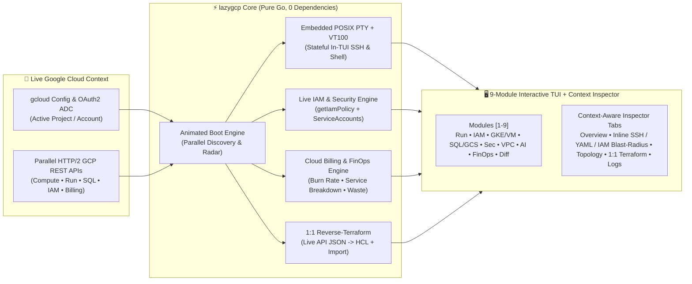

<div align="center">
  <h1>⚡ lazygcp</h1>
  <p><strong>The Blazing-Fast Terminal UI (TUI), Inline SSH Cockpit, Live Security/IAM Auditor & Cloud Billing FinOps Engine for Google Cloud</strong></p>
  <p>
    
    
    
    
    
    <a href="./LICENSE"></a>
  </p>
</div>

---

> **Stop waiting 15 seconds for the Google Cloud Console to load browser tabs or memorizing 60-character `gcloud` flags.**  
> `lazygcp` brings the speed and muscle memory of `k9s` and `lazydocker` to **Google Cloud Platform**—initializing with a live animated telemetry radar and connecting directly to your `gcloud` project to give you **9 real-time operational modules**, an **embedded POSIX PTY & VT100 SSH terminal inside the TUI**, **live Project IAM & Security posture assessment**, **Cloud Billing API v1 burn-rate & waste analytics**, **1-key firewall quarantine**, and **1:1 state-accurate Reverse-Terraform HCL export**.

---

## 🌟 Why Engineers Switch to `lazygcp`

| Everyday GCP Pain | Traditional Console / `gcloud` CLI | ⚡ With `lazygcp` |
| :--- | :--- | :--- |
| **SSH into Compute VMs** | Copy zone/project flags, open separate terminal windows, check if VM is stopped | **Module `[3 :gke]`**: Live VM power status (`POWERED ON` / `POWERED OFF`) + **embedded POSIX PTY & VT100 SSH terminal (`[s]`)** right inside the TUI (`Ctrl+F` full-height, blocked automatically when VM is off) |
| **Inspecting Cloud Run & Functions** | Click through 5 console tabs to find env vars, YAML, or revisions | **Module `[1 :run]`**: Live revision traffic splits, **Service YAML export (`[y]`)**, secret unmasking (`[x]`), interactive container shell (`[s]`), and **1-key rollback (`[r]`)** |
| **Over-Privileged Live IAM (`roles/editor`)** | Parse massive JSON outputs from `gcloud projects get-iam-policy` | **Module `[2 :iam]`**: Audits live project IAM policies & Service Accounts (`roles/owner`, `roles/editor`, `allUsers`, Default Compute SAs), shows blast-radius capabilities & exports 1:1 least-privilege Terraform |
| **Querying Cloud SQL & GCS Buckets** | Switch between `gsutil`, `gcloud storage`, and SQL clients | **Module `[4 :sql]`**: **Interactive SQL query prompt (`[e]`)**, live GCS bucket object listing (`ls -lh`), and 1-key Cloud SQL Auth Proxy (`[p]`) |
| **Blocking Active Network Attacks** | Navigate VPC Firewall menus while traffic hits `0.0.0.0/0` | **Module `[6 :net]`**: **1-Key Emergency Firewall Block (`[b]`)** immediately quarantines exposed `0.0.0.0/0` ingress rules to `DENY` (priority 100) |
| **Surprise Cloud Bills & Idle Spend** | Wait for next month's billing invoice | **Module `[8 :cost]`**: Queries **Cloud Billing API v1** for linked Billing Account, Daily/Monthly/Annual Burn Rate, **Service Family Spend Breakdown**, and 1-key waste cleanup |
| **"What Changed 20 Mins Ago?!"** | Write complex `cloudaudit.googleapis.com` queries | **Module `[9 :diff]`**: Streams live Cloud Audit Logs as **`git diff` blocks**, inspects full JSON audit payloads (`[e]`), and generates rollback commands (`[r]`) |
| **ClickOps -> Terraform** | Manually write `.tf` blocks for existing resources | **1:1 Reverse-Terraform (`[t]` / `[w]`)**: Generates exact 1:1 Terraform HCL mapped from live GCP API JSON (boot disks, NICs, subnets, labels, plus `terraform import`) |

---

## 🏗️ System Architecture



---

## 🚀 Installation & Quickstart

`lazygcp` is engineered in **100% pure Go with zero external dependencies**—it compiles into a single native binary in under 1 second on macOS (`arm64` / `amd64`), Linux (`arm64` / `amd64`), and Windows (`amd64`).

### Option A: Install via `go install`
```bash
go install github.com/damiansztankowski/lazygcp@latest
```

### Option B: Build from Source
```bash
git clone https://github.com/damiansztankowski/lazygcp.git
cd lazygcp
make build

# Optional: Install globally into your PATH
sudo mv lazygcp /usr/local/bin/
```

### 1. Launch Live Interactive Cockpit (Default)
Running `lazygcp` launches the animated initialization radar while concurrently discovering your active `gcloud` project, resources, live IAM policy bindings, and Cloud Billing status:

```bash
lazygcp
```

### 2. Target a Specific GCP Project or Switch Live Inside the TUI
Pass `-p` on startup, or press **`P` (`Shift+p`)** at any time inside `lazygcp` to open the **Interactive Project Switcher Modal** (`gcloud projects list` with live search):

```bash
# Connect to a specific project ID
lazygcp -p my-production-gcp-project

# Boot directly into a specific module (run, iam, gke, sql, sec, net, ai, cost, rewind)
lazygcp iam -p my-production-gcp-project
lazygcp gke -p my-production-gcp-project
lazygcp cost
```

### 3. Offline Demo Mode (`--demo`)
Presenting on stage at a conference or testing without internet access? Launch the rich simulated fintech production environment:

```bash
lazygcp --demo
```

---

## 🧭 The 9 GCP Cockpit Modules (`1`–`9` or `:command`)

| Key | `:cmd` | Module | What It Audits & Controls Live |
| :---: | :---: | :--- | :--- |
| **`1`** | `:run` | **🚀 Cloud Run & Functions** | Live services & functions, revision traffic splits, `minScale`/`maxScale`, **Knative Service YAML (`[y]`)**, plaintext secret unmasking (`[x]`), interactive container proxy/exec (`[s]`), and 1-key rollback (`[r]`). |
| **`2`** | `:iam` | **◆ IAM Policies & Roles** | Live project IAM & Security posture assessment (`getIamPolicy` + `serviceAccounts`), plain-English breakdown of WHO has access (`roles/owner`, `roles/editor`, `allUsers`, Default Compute SAs), dangerous permission exposure (`[z]`), and 1-key remediation (`[f]`). |
| **`3`** | `:gke` | **⎈ GKE & Compute VMs** | Explicit VM power states (`POWERED ON (RUNNING)`, `POWERED OFF (STOPPED)`), **embedded POSIX PTY & VT100 SSH terminal (`[s]` / `[S]`)** with **Direct SSH vs. IAP Tunnel selector** & **1-key IAP Best-Practices auto-configuration**, and GKE cluster telemetry. |
| **`4`** | `:sql` | **▤ Cloud SQL & Storage** | **Interactive SQL query execution (`[e]`)** on Cloud SQL instances, **live GCS bucket file browser (`[e]`)** (`gcloud storage ls -l`), public access prevention checks, and 1-key Cloud SQL Auth Proxy (`[p]`). |
| **`5`** | `:sec` | **🔑 Secrets & KMS Vault** | Secret Manager inventory, rotation policies, version state, and temporary audited secret payload unmasking (`[x]`). |
| **`6`** | `:net` | **🌐 VPC, NAT & Firewalls** | Detailed ingress/egress firewall analysis (`Allowed Ports`, `Source CIDRs`, `Target Tags`), **1-Key Emergency Block (`[b]`)** to quarantine `0.0.0.0/0` rules, and live Firewall Hit Logs (`[e]`). |
| **`7`** | `:ai` | **🤖 Vertex AI & GenAI** | Enabled Vertex AI, Gemini (`generativelanguage`), and Discovery Engine APIs, token burn guardrails, and Model Armor templates. |
| **`8`** | `:cost` | **💸 FinOps & Cloud Billing** | **Cloud Billing API v1** overview (`💳 Cloud Billing` account name/ID, active status, currency), **Daily / Monthly / Annual Burn Rate**, **Service Family Spend Breakdown bars**, unattached disk / idle `minScale` detection, and 1-key cleanup (`[e]`). |
| **`9`** | `:diff` | **⏪ Audit Time-Machine** | Streams live `cloudaudit.googleapis.com` admin activity as unified **`git diff` blocks**, **inspects full raw Audit Log JSON (`[e]`)**, and generates/runs the **rollback `gcloud` command (`[r]`)**. |

---

## 🖥️ Embedded Inline POSIX PTY SSH Terminal & IAP Best-Practices Setup (Module 3)

When selecting a **running Compute Engine VM** (`POWERED ON (RUNNING)`) in **Module 3 (`[3] GKE & Compute VMs`)**:

1. **Choose Direct SSH or Zero-Trust IAP Tunnel (`[s]` / `[S]`):** Pressing **`s`**, **`Enter`**, or **`S`** opens the **VM SSH Connection Mode Selector Modal**, allowing you to choose between:
   * **`[1] Direct SSH`:** Standard SSH connection (`gcloud compute ssh <vm> --zone=<zone> --project=<project>`).
   * **`[2] IAP Tunnel SSH`:** Zero-Trust SSH over HTTPS via Google Identity-Aware Proxy (`gcloud compute ssh <vm> --zone=<zone> --project=<project> --tunnel-through-iap`).
   * **`[3] Configure IAP Best Practices & Connect`:** Automatically configures IAP TCP forwarding for the VM's VPC and connects.
2. **Automatic IAP Detection & Best-Practices Configuration Prompt:** If you select **IAP Tunnel SSH** and `lazygcp` detects that the VM's VPC network does not yet have an IAP TCP forwarding firewall rule (`35.235.240.0/20` $\rightarrow$ `tcp:22`), `lazygcp` prompts you (`[y/N]`) to automatically configure IAP according to **Google Cloud Best Practices**:
   * Enables the **Identity-Aware Proxy API** (`gcloud services enable iap.googleapis.com`).
   * Creates the **least-privilege ingress firewall rule** (`allow-ssh-ingress-from-iap` allowing `tcp:22` only from Google IAP's `35.235.240.0/20` range on the VM's VPC).
   * Grants the **least-privilege IAM role** (`roles/iap.tunnelResourceAccessor`) to your active account, and immediately opens the inline SSH session over IAP.
3. **Full Interactive Shell & Full-Height Toggle:** Persistent working directory (`cd`), shell history (`↑`/`↓`), `Tab` autocompletion, `Ctrl+C`, `Ctrl+L`, `top`, `htop`, and `vim` work seamlessly inside the TUI. Press **`Ctrl+F`** to toggle full-screen height, or **`Esc`** / **`Ctrl+]`** to detach while keeping your SSH session running in the background.
4. **Power-State Safety Guard:** If a VM is `POWERED OFF (STOPPED)` or `SUSPENDED`, `lazygcp` automatically hides the SSH terminal tab and blocks `[s]` / `[e]` with a clear warning banner and the exact `gcloud compute instances start` command.

---

## 🔬 Context-Aware Inspector Tabs (Bottom Pane)

The bottom inspector adapts its tabs to the active module so VM terminal sessions, Cloud Run YAML, and live IAM blast-radius analysis stay cleanly isolated (cycle with **`Tab`** or jump with **`v`**, **`y`**, **`z`**, **`g`**, **`t`**, **`a`**):

* **`[v] Overview`:** Live telemetry, power state, Cloud Billing burn-rate breakdown (Module 8), VPC exposure summary (Module 6), and context-specific action guide (with full multi-line text wrapping so long lines never get cut off).
* **Module-Specific Deep View:**
  * **Module 1 (Cloud Run & Functions):** **`[y] Service YAML`** (full Knative YAML manifest & env vars).
  * **Module 2 (IAM Policies & Roles):** **`[z] Role & Blast-Radius`** (granted vs. minimal workload permissions and dangerous capabilities exposed on the live project).
  * **Module 3 (GKE & Compute VMs):** **`[s] Live SSH Terminal`** (Direct SSH or IAP Tunnel, shown only when VM is `POWERED ON (RUNNING)`).
* **`[t] 1:1 Terraform`:** State-accurate Terraform HCL reverse-engineered directly from the live GCP resource JSON, complete with the matching `terraform import` command. Press **`[w]`** to write `.tf` to disk.
* **`[a] Cloud Logs`:** Streams live Cloud Logging entries (`gcloud logging read`) and SRE remediation guidance with automatic multi-line wrapping.

---

## ⌨️ Complete Keyboard Reference

Press **`?`** anywhere inside `lazygcp` to open the interactive **3-Page Extended Help Modal**.

| Shortcut | Action |
| :--- | :--- |
| `↑` / `↓` or `j` / `k` | Move selection up / down in the current resource table |
| `←` / `→` or `h` / `l` | Switch to previous / next GCP module (`1`–`9`) |
| `1` – `9` | Jump directly to GCP Module `1` through `9` |
| `Tab` | Cycle bottom Inspector sub-tabs |
| `P` (`Shift+p`) | **Interactive Project Switcher** — search & switch across all accessible GCP projects |
| `s` / `S` | **Inline PTY SSH Terminal / Mode Selector** — choose **Direct SSH**, **IAP Tunnel SSH**, or **Auto-Configure IAP Best Practices** on running VMs |
| `Ctrl+F` / `Esc` | Toggle **Full-Height SSH Terminal** / Unfocus SSH terminal back to table navigation |
| `e` | **Context Action / Exec** — run remote VM command (Mod 3), SQL query or GCS `ls` (Mod 4), FW logs (Mod 6), FinOps cleanup (Mod 8), or Audit JSON inspect (Mod 9) |
| `b` | **Emergency Firewall Block** — immediately quarantine an open `0.0.0.0/0` firewall rule to `DENY` (Module 6) |
| `y` | **Service YAML** — inspect full Cloud Run / Cloud Function YAML manifest (Module 1) |
| `r` | **1-Keystroke Rollback** — shift Cloud Run traffic to previous healthy revision (Mod 1) or execute Audit Log rollback (Mod 9) |
| `p` | **Start Local Proxy Tunnel** — launch background Cloud SQL Auth Proxy or IAP tunnel |
| `t` / `w` | **1:1 Reverse-Terraform** — view or export state-accurate HCL to `<resource>.tf` |
| `x` | **Unmask / Mask Secrets** — toggle visibility of sensitive environment variables and Secret Manager payloads |
| `R` (`Shift+r`) | **Live Refresh** — re-query Google Cloud APIs for the current project |
| `/` | **Live Fuzzy Filter** — filter current table by name, region, kind, or status |
| `:` | **Command Palette** — execute `:run`, `:iam`, `:gke`, `:sql`, `:sec`, `:net`, `:ai`, `:cost`, `:diff`, `:project`, `:q` |
| `?` / `q` | Open 3-page Extended Help Modal / Quit `lazygcp` |

---

## 🤝 Contributing & Security

- Please read [`CONTRIBUTING.md`](./CONTRIBUTING.md) for architecture guidelines, cross-platform build tags, and Pull Request workflow.
- Please read [`SECURITY.md`](./SECURITY.md) for our zero-telemetry credential model and vulnerability reporting process.
- Open [`docs/index.html`](./docs/index.html) in any browser to explore the interactive **`lazygcp` Product Website**.

---

## 📄 License

Licensed under the **Apache License, Version 2.0** (the "License"). You may obtain a copy of the License at [`LICENSE`](./LICENSE) or [http://www.apache.org/licenses/LICENSE-2.0](http://www.apache.org/licenses/LICENSE-2.0).

Built with ❤️ for the Google Cloud, SRE & DevSecOps community.
